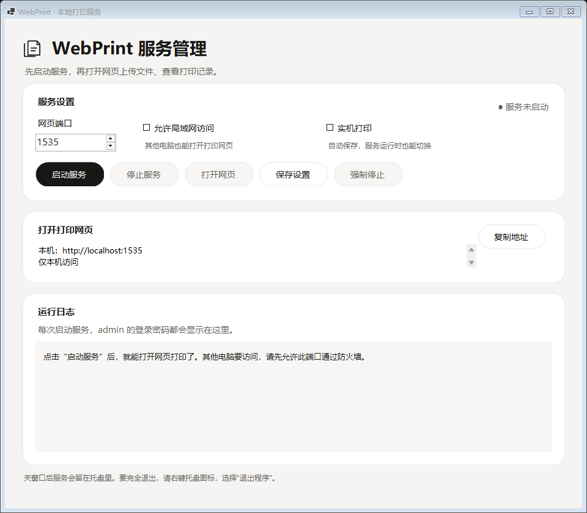
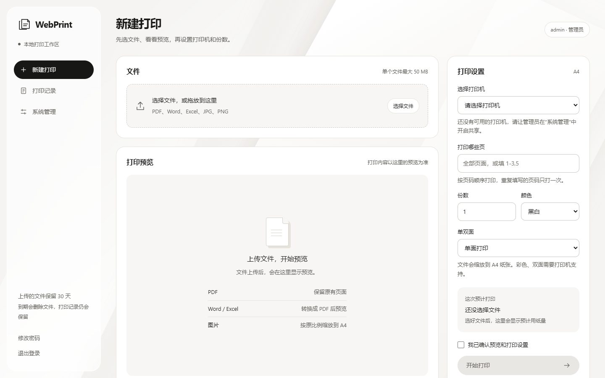

# WebPrint

在浏览器上传文件，由局域网内的一台 Windows 电脑负责打印，并保存打印记录和页数。

[下载最新便携版](https://github.com/WilliamJKYuan/webprint/releases/latest) · [迁移与升级](MIGRATION.md) · [开发与配置](docs/DEVELOPMENT.md) · [更新记录](CHANGELOG.md)

## 下载安装

1. 在 [Releases](https://github.com/WilliamJKYuan/webprint/releases) 下载 Windows x64 ZIP，完整解压到可写目录。
2. 双击 `Start-WebPrint.cmd` 或 `WebPrint.Desktop.exe`，设置网页端口，点击“启动服务”。目标电脑不需要安装 .NET、Python 或 Node.js。
3. 在运行日志中查看 `admin` 密码，点击“打开网页”登录。
4. 在服务电脑安装打印机驱动，并在网页“系统管理”中开启需要共享的打印机。
5. 确认打印机可以正常使用后，在桌面勾选“实机打印”。新发布包默认关闭这个选项。
6. 其他电脑用浏览器访问桌面显示的局域网地址。Windows 防火墙需要允许对应端口，程序不会自动修改防火墙。

**Word / Excel 可使用 LibreOffice 或桌面版 Microsoft Office。** 在服务电脑安装相应软件后，以管理员登录网页，进入“系统管理 → Word / Excel 转换”，选择软件并点击“保存选择”。立即用于之后上传的文件，已有预览不会改变，重启和迁移后保留选择。PDF 和图片预览不依赖这两种软件。

当前便携包包含 SumatraPDF，不捆绑 LibreOffice 或 Microsoft Office。选择 Microsoft Office 时，请先在服务电脑打开 Word 和 Excel 完成激活、登录及首次设置，并保持 Windows 用户登录。Office 自动化可能遇到弹窗或卡住；转换设有 90 秒超时，不会自动改用其他软件。适合受控、有人管理的局域网电脑；微软不推荐将桌面 Office 用于无人值守的非交互式服务器自动化，见[微软说明](https://learn.microsoft.com/en-us/office/client-developer/integration/considerations-unattended-automation-office-microsoft-365-for-unattended-rpa)。

发布包的 SHA-256 校验文件与 ZIP 一起提供。在 PowerShell 运行 `Get-FileHash .\下载的文件.zip -Algorithm SHA256`，与校验文件中的值核对。

## 界面

桌面管理采用纯暖白背景，用于设置端口、管理服务和查看日志。



网页负责上传、预览、打印和查看记录，适配电脑、平板与手机。图片和字体不依赖外部服务。



## 能做什么

- 上传 PDF、DOC/DOCX、XLS/XLSX、JPG/JPEG 和 PNG，单文件最大 50 MB、最多 2000 页。
- 先查看 PDF 预览，再选择打印机、页码、份数、单双面和黑白/彩色；对应功能需要设备和驱动支持。
- 普通用户只看自己的文件与记录；管理员管理账户、共享打印机、核对打印结果并导出全部记录。
- 保存文件名、文件哈希、提交人、时间、打印设置、预计页数和人工确认的实际页数。
- 桌面支持实时切换实机打印、最小化到托盘、双击恢复、托盘右键退出。
- 复制整个运行目录即可换电脑，保留账户、文件和打印记录；目标电脑需重新配置驱动。

## 打印记录怎么看

“已发送”表示打印程序接受了文件，**不代表打印机已经把纸打出来**。当前版本不会自动读取设备实际出纸数量，请在打印机旁确认后，由管理员点击“登记结果”填写实际页数。

| 网页状态 | 含义 |
| --- | --- |
| 等待打印 | 还在排队，可以取消 |
| 正在发送 | 正在准备或发送到打印程序 |
| 已发送，待确认 | 打印程序返回成功，需要确认是否出纸 |
| 结果待确认 | 发送时发生超时或中断，可能已经打印了一部分 |
| 发送失败 | 没有进入打印程序的发送阶段 |
| 已取消 | 已取消排队中的记录 |
| 已核对 | 管理员登记了核对结果；实际页数仍可留空表示未知 |

预计打印页数为选中页数乘以份数；双面用纸量按每份向上取整估算。失败或取消的记录不计入预计打印页数。筛选影响网页统计，CSV 导出包含全部记录。

本程序只记录经过网页提交的打印，直接从其他软件发起的打印不会自动纳入记录。

## 换电脑或升级

从托盘右键选择“退出程序”，等待服务退出后，再复制或备份整个目录。`data/` 包含账户、密钥、文件和打印记录；不要只复制 EXE，也不要在服务运行时直接复制数据库。

升级建议解压到新目录，再迁移原数据和配置。检测到换电脑时，系统会停用原共享打印机并暂停旧队列，避免误打。完整步骤见[迁移说明](MIGRATION.md)。

## 账户和数据

- 新密码长度为 6～200 个字符。每次启动服务会在桌面日志中显示当前 `admin` 密码，这是本项目的明确功能。
- 登录使用密码哈希；为支持重复显示，admin 密码还会以可解密形式加密保存在本地数据库，密钥位于 `data/keys/`。能读取数据库和密钥或查看运行日志的人可能获得该密码，请限制运行目录和日志的访问权限。
- 上传文件默认保留 30 天，到期删除文件，保留打印记录。完整数据目录、备份和带数据的发布包都应妥善保管。
- 适合受控局域网。使用真实账户和文件前配置受信任的 HTTPS；当前转换进程没有操作系统级沙箱，不应直接向公网开放。

## 从源码运行

开发环境需要 Windows 和 .NET 9 SDK；日常使用请直接下载便携包。

```powershell
git clone https://github.com/WilliamJKYuan/webprint.git
cd webprint
dotnet build WebPrint.csproj
.\start.ps1
```

制作带桌面入口和 .NET 运行环境的便携包：

```powershell
powershell -NoProfile -ExecutionPolicy Bypass -File scripts/build-portable.ps1
```

第三方程序不会保存在源码仓库中。按[开发与配置说明](docs/DEVELOPMENT.md)安装或指定转换、打印组件；打包组件的方法见[迁移说明](MIGRATION.md#从源代码制作发布包)。

## 项目结构

| 路径 | 用途 |
| --- | --- |
| 根目录 C# 文件、`WebPrint.csproj` | 网页 API、账户、打印队列和审计 |
| `Launcher/` | Windows 桌面管理与托盘 |
| `wwwroot/` | 网页界面 |
| `Shared/` | 便携目录和语言资源加载 |
| `BuildTools/`、`scripts/`、`portable/` | 发布目录整理、构建和启动入口 |
| `tests/`、`SelfTests.cs` | 隔离数据下的功能验证 |
| `docs/` | 配置、开发说明和界面截图 |

第三方组件及其来源见 [THIRD-PARTY.md](THIRD-PARTY.md)。
